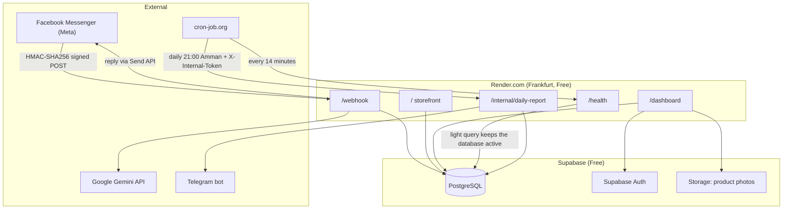

# 🌹 Hajj & Umrah Gifts Store — Facebook Messenger AI Sales Agent & Dashboard
### Messenger sales bot in the Jordanian dialect, public storefront, and RTL admin dashboard

A complete system that automates sales for a Hajj and Umrah goods and gifts store in Jordan over Facebook Messenger, using AI (Gemini) that speaks the Jordanian dialect. It includes a public storefront (with no prices), an Arabic (RTL) dashboard for managing products and conversations, and a daily Telegram report of the day's orders to hand over to the delivery company.

---

## 📑 Contents
1. [Overview and architecture](#1--overview-and-architecture)
2. [Running locally and tests](#2--running-locally-and-tests)
3. [Deploying to Render.com and cron-job.org](#3--deploying-to-rendercom-and-cron-joborg)
4. [Moving from the test Facebook page to the real store page](#4--moving-from-the-test-facebook-page-to-the-real-store-page)
5. [Reference: database, admin account, security](#5--reference)

---

## 1. 🏛️ Overview and architecture

### What does the system do?
- **Messenger bot in the Jordanian dialect:** suggests products from the real catalog only, recognizes a product from a photo the customer sends, and collects the order details (name, phone, governorate, address) all at once or step by step.
- **Prices calculated in code, in Jordanian dinars (JOD):** to 3 decimal places, with a flat delivery fee set on the settings page. The AI never calculates prices.
- **Jordanian phone number normalization:** converts Arabic-Indic digits and the +962 / 00962 formats to the 07XXXXXXXX format.
- **Public storefront (`/`):** shows products **without any prices** (neither in the HTML nor in `/api/public/products`), with an "Ask about the price on Messenger" button.
- **Dashboard (`/dashboard`):** products, categories, types, FAQs, bot simulator, reports, settings, and the admin account.
- **Telegram:** a daily report of confirmed orders (9:00 PM Amman time) plus an instant alert when a customer is upset.

### Architecture



### Tech stack
Python 3.11 · FastAPI · Jinja2 + Bootstrap 5 RTL · Supabase (PostgreSQL + Auth + Storage) · Google Gemini (`google-genai`) · Meta Graph API · Telegram Bot API · Render.com · cron-job.org

### Project structure
```
Messenger_Agent/
├── app/
│   ├── ai/            # Gemini provider, prompt building, response parsing
│   ├── dashboard/     # Dashboard routes, sessions, CSRF, rate limiting
│   ├── db/            # Supabase client and repositories
│   ├── messenger/     # Webhook handler, Send API, signature verification
│   ├── models/        # Pydantic models
│   ├── routes/        # health, webhook, internal, storefront
│   ├── services/      # Business logic (orders, prices, phones, reports)
│   ├── telegram/      # Daily report and alerts
│   ├── templates/     # Arabic Jinja2 templates
│   ├── config.py      # Settings from environment variables
│   └── main.py        # App factory
├── migrations/        # Numbered SQL files (001 → 009)
├── scripts/           # Local conversation simulator + demo product data
├── static/            # CSS / JS / logo
├── tests/             # pytest tests
├── render.yaml        # One-click Render deployment config
├── Dockerfile         # Alternative Docker deployment
└── .env.example       # Environment variable template, every key explained
```

---

## 2. 🚀 Running locally and tests

### Requirements
- Python 3.11 or newer
- A (free) Supabase project with the `migrations/` files applied (see [Database](#database-supabase))

### Setup
```bash
python -m venv .venv
# Windows:
.venv\Scripts\activate
# Linux/macOS:
source .venv/bin/activate

pip install -r requirements-dev.txt
cp .env.example .env      # then fill in the values; every key is explained in the file
```

> Keep `APP_ENV=development` in your local `.env` file. If this variable is not set, the app runs as **production** by default (the safer choice).

### Running
```bash
uvicorn app.main:app --reload --port 8080
```
- Storefront: http://localhost:8080/
- Dashboard: http://localhost:8080/dashboard
- API docs (development mode only): http://localhost:8080/docs
- Health check: http://localhost:8080/health

In development mode only, you can sign in to the dashboard with `admin@example.com` / `admin123` without Supabase Auth. **This login is fully disabled in production.**

### Trying the bot without Facebook
```bash
python scripts/test_messenger_locally.py
```
Or from the dashboard: **Bot simulator**. Simulator orders are marked as test orders and do not appear in the delivery report.

### Tests
```bash
pytest            # all tests (no Supabase or Meta connection needed)
make test-cov     # with a coverage report
```

---

## 3. ☁️ Deploying to Render.com and cron-job.org

### Step 1: Push the project to GitHub
Make sure `.env` is not committed (`git status` should not show it; it is excluded in `.gitignore`).

### Step 2: Create the service on Render
1. Go to [dashboard.render.com](https://dashboard.render.com) → **New → Blueprint** → pick the repository.
2. Render reads `render.yaml` automatically: a Web service, Python 3.11.9, Frankfurt region, free plan, health check on `/health`.
3. Render will ask for the secret values (the ones marked `sync: false`). Copy them from your local `.env` or from their sources (explained in `.env.example`):

   | Variable | Where to get it |
   |---|---|
   | `SUPABASE_URL`, `SUPABASE_ANON_KEY`, `SUPABASE_SERVICE_ROLE_KEY` | Supabase → Project Settings → API |
   | `GEMINI_API_KEY` | aistudio.google.com/apikey |
   | `META_APP_SECRET`, `META_PAGE_ACCESS_TOKEN`, `META_VERIFY_TOKEN` | The Meta app (see section 4) |
   | `FACEBOOK_PAGE_ID` | The Facebook page's ID |
   | `TELEGRAM_BOT_TOKEN`, `TELEGRAM_CHAT_ID` | @BotFather and getUpdates |
   | `APP_BASE_URL` | Leave empty for now and fill it in after the first deploy |

   Render generates `INTERNAL_API_TOKEN` automatically with a random value.
4. After the first successful deploy, copy the service URL (e.g. `https://messenger-agent.onrender.com`) into `APP_BASE_URL` under **Environment**, then add `https://YOUR-APP.onrender.com/auth/**` in Supabase → Authentication → URL Configuration → Redirect URLs.
5. Verify: open `https://YOUR-APP.onrender.com/health`; you should see `"status": "healthy"` and `"database": "connected"`.

> **Render free plan notes:** the service sleeps after 15 minutes without traffic (which is why we use cron-job.org), and the plan gives 750 hours a month, enough for one service running 24/7. The start command includes `--proxy-headers --forwarded-allow-ips="*"` so links and redirects stay on `https://` behind Render's load balancer.

### Step 3: Connect the Messenger webhook
In the Meta app → Messenger → Webhooks:
- **Callback URL:** `https://YOUR-APP.onrender.com/webhook`
- **Verify Token:** the same value as `META_VERIFY_TOKEN`
- Subscribe to: `messages`, `messaging_postbacks`

### Step 4: cron-job.org jobs (free)
Create an account on [cron-job.org](https://cron-job.org), then create two jobs:

**A) Keep the server and database awake**
- **URL:** `https://YOUR-APP.onrender.com/health`
- **Schedule:** Custom → `*/14 * * * *` (every 14 minutes)
- **Method:** GET

This stops Render from putting the service to sleep, and runs a light query on Supabase that stops the free project from being paused after 7 days of inactivity. `/health` always responds within 5 seconds at most.

**B) Daily Telegram report at 9:00 PM**
- **URL:** `https://YOUR-APP.onrender.com/internal/daily-report`
- **Schedule:** Every day at **21:00**, with **Time zone: Asia/Amman** (in the job settings)
- **Advanced → Request method:** POST
- **Advanced → Headers:** `X-Internal-Token` = the value of `INTERNAL_API_TOKEN` (from Render → Environment)

Without the correct header the server rejects the request (403), and if `INTERNAL_API_TOKEN` is empty it rejects every request (503). The report is never sent twice for the same day, so retries are safe. The daily report can be turned off or sent manually from Dashboard → **Reports**.

---

## 4. 🔁 Moving from the test Facebook page to the real store page

The page the bot replies on is set by **two Render variables** only; no code changes are needed:
- `META_PAGE_ACCESS_TOKEN`: permission to send replies as the page.
- `FACEBOOK_PAGE_ID`: used in the "Message us on Messenger" (m.me) links on the storefront and the privacy page.

### Steps
1. **Admin access:** the account that manages the Meta app must be an Admin of the real store page.
2. **Connect the page to the app:** developers.facebook.com → your app → Messenger → **API Settings** → **Add Page** and pick the store page.
3. **Generate a new token:** next to the page, click **Generate token** and copy it.
4. **Subscribe to events:** on the same page, subscribe the page to `messages` and `messaging_postbacks`.
5. **Unsubscribe the test page** from the same list, so its messages don't get mixed in with the real store's orders (all subscribed pages are recorded under the same store).
6. **Update Render:** Environment → change:
   - `META_PAGE_ACCESS_TOKEN` = the new token
   - `FACEBOOK_PAGE_ID` = the store page's ID (from the page → About → Page transparency)

   Then **Save Changes**, and Render redeploys automatically within a minute or two.
7. **(Optional, for record-keeping)** In Supabase → Table Editor → `stores`, update `facebook_page_id` to the new page's ID. The app does not currently read this column, but it keeps the data consistent.
8. **Public availability:** for the bot to reply to all customers (not only the app's admins), the app must be in **Live** mode with the `pages_messaging` permission (Advanced Access) through **App Review**. The required privacy policy URL is `https://YOUR-APP.onrender.com/privacy`.
9. **Test:** send a message to the store page from a personal account and confirm the reply arrives, then check that the Messenger links on the storefront open the right page.

> **Important:** a token generated from Messenger API Settings usually does not expire, but it is revoked if the page admin changes their password or removes the app's permissions. If the bot suddenly stops replying, generate a new token and update it in Render.

---

## 5. 📚 Reference

### Database (Supabase)
Apply the files in order from **Supabase Dashboard → SQL Editor** (copy, paste, then Run):

| File | Purpose |
|---|---|
| `001_initial_schema.sql` | Tables, RLS, indexes |
| `002_seed_data.sql` | Default store, bot persona, FAQs |
| `003_product_categories.sql` | Product categories and storefront filters |
| `004_product_types.sql` | Product types |
| `005_drop_delivery_zones.sql` | Drops delivery zones (replaced by a flat fee) |
| `006_security_hardening.sql` | Fixes for Supabase security advisor warnings |
| `007_report_history_is_scheduled.sql` | Distinguishes scheduled reports from manual ones |
| `008_product_images_bucket.sql` | Product photo storage bucket |
| `009_orders_is_test.sql` | Flags simulator orders so they are excluded from the report |

### Admin account
- **Create the account:** Supabase → Authentication → Users → **Add user** (email + password).
- **View-only (demo) account:** add `{"role": "demo"}` to the user's `app_metadata`. It can only browse and try the simulator.
- From the **Account & security** page (`/dashboard/account`): change the email (with a confirmation link) and password. From the login page: **Forgot your password?**
- **One-time Supabase setup:**
  1. Authentication → URL Configuration: **Site URL** = `APP_BASE_URL`, and **Redirect URLs** include `https://YOUR-APP.onrender.com/auth/**` (and `http://localhost:8080/auth/**` for local testing).
  2. Authentication → Emails → SMTP Settings: enable **Custom SMTP** through Gmail (Host `smtp.gmail.com`, Port `587`, an app password from [myaccount.google.com/apppasswords](https://myaccount.google.com/apppasswords)). The default server is limited to about two emails an hour.

### Security in production
- `/docs`, `/redoc` and `/openapi.json` are hidden.
- The webhook rejects any request without a valid `X-Hub-Signature-256` signature.
- `/internal/daily-report` is protected by `X-Internal-Token` (constant-time comparison) and rejects everything if it isn't set.
- Unexpected errors are shown as an Arabic-language page/message with no technical details; the details are in the Render logs only.
- Logs contain no tokens (Telegram/Meta/Supabase) and no request URLs carrying customer phone numbers.
- CSRF protection on every dashboard form, login rate limiting, and `Secure` + `HttpOnly` cookies.
- The `SUPABASE_SERVICE_ROLE_KEY` is used on the server only and never reaches the browser.

### Deploying with Docker (alternative)
```bash
make docker-build
make docker-run      # reads .env and exposes port 8080
```
