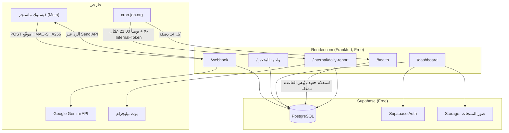

# 🌹 متجر هدايا الحج والعمرة — مساعد مبيعات فيسبوك ماسنجر ولوحة التحكم
### Hajj & Umrah Gifts Store — Facebook Messenger AI Sales Agent & RTL Dashboard

نظام متكامل لأتمتة مبيعات متجر بضائع وهدايا الحج والعمرة في الأردن عبر Facebook Messenger بالذكاء الاصطناعي (Gemini) وباللهجة الأردنية، مع واجهة متجر عامة (بدون أسعار)، ولوحة تحكم عربية (RTL) لإدارة المنتجات والمحادثات، وتقرير يومي على تيليجرام بطلبات اليوم لتسليمها لشركة التوصيل.

---

## 📑 المحتويات
1. [نظرة عامة والمخطط المعماري](#1--نظرة-عامة-والمخطط-المعماري)
2. [التشغيل المحلي والاختبارات](#2--التشغيل-المحلي-والاختبارات)
3. [النشر على Render.com و cron-job.org](#3--النشر-على-rendercom-و-cron-joborg)
4. [الانتقال من صفحة فيسبوك التجريبية إلى صفحة المتجر الحقيقية](#4--الانتقال-من-صفحة-فيسبوك-التجريبية-إلى-صفحة-المتجر-الحقيقية)
5. [مراجع: قاعدة البيانات، حساب المدير، الأمان](#5--مراجع)

---

## 1. 🏛️ نظرة عامة والمخطط المعماري

### ماذا يفعل النظام؟
- **بوت ماسنجر باللهجة الأردنية:** يقترح منتجات من الكتالوج الفعلي فقط، يتعرف على المنتج من صورة يرسلها الزبون، ويجمع بيانات الطلب (الاسم، الهاتف، المحافظة، العنوان) دفعة واحدة أو خطوة بخطوة.
- **حساب الأسعار برمجياً بالدينار (JOD):** بدقة 3 خانات عشرية، مع رسوم توصيل ثابتة من صفحة الإعدادات. الذكاء الاصطناعي لا يحسب الأسعار أبداً.
- **تطبيع أرقام الهواتف الأردنية:** يحوّل الأرقام الهندية (٠-٩) وصيغ +962 / 00962 إلى الصيغة 07XXXXXXXX.
- **واجهة متجر عامة (`/`):** تعرض المنتجات **بدون أي أسعار** (لا في HTML ولا في `/api/public/products`)، وزر "اسأل عن السعر عبر ماسنجر".
- **لوحة تحكم (`/dashboard`):** المنتجات، الفئات، الأنواع، الأسئلة الشائعة، محاكي البوت، التقارير، الإعدادات، وحساب المدير.
- **تيليجرام:** تقرير يومي بالطلبات المؤكدة (9:00 مساءً بتوقيت عمّان) + تنبيه فوري عند زبون منزعج.

### المخطط



### التقنيات
Python 3.11 · FastAPI · Jinja2 + Bootstrap 5 RTL · Supabase (PostgreSQL + Auth + Storage) · Google Gemini (`google-genai`) · Meta Graph API · Telegram Bot API · Render.com · cron-job.org

### هيكل المشروع
```
Messenger_Agent/
├── app/
│   ├── ai/            # مزود Gemini، بناء التعليمات، تحليل الرد
│   ├── dashboard/     # مسارات لوحة التحكم، الجلسات، CSRF، تحديد المحاولات
│   ├── db/            # عميل Supabase والمستودعات (Repositories)
│   ├── messenger/     # معالج Webhook، Send API، التحقق من التوقيع
│   ├── models/        # نماذج Pydantic
│   ├── routes/        # health, webhook, internal, storefront
│   ├── services/      # منطق الأعمال (الطلبات، الأسعار، الهواتف، التقارير)
│   ├── telegram/      # التقرير اليومي والتنبيهات
│   ├── templates/     # قوالب Jinja2 العربية
│   ├── config.py      # الإعدادات من متغيرات البيئة
│   └── main.py        # إنشاء التطبيق
├── migrations/        # ملفات SQL مرقمة (001 → 009)
├── scripts/           # محاكي المحادثة المحلي + بيانات منتجات تجريبية
├── static/            # CSS / JS / الشعار
├── tests/             # اختبارات pytest
├── render.yaml        # إعداد النشر على Render بنقرة واحدة
├── Dockerfile         # بديل للنشر عبر Docker
└── .env.example       # قالب متغيرات البيئة مع شرح كل مفتاح
```

---

## 2. 🚀 التشغيل المحلي والاختبارات

### المتطلبات
- Python 3.11 أو أحدث
- مشروع Supabase (مجاني) طُبّقت عليه ملفات `migrations/` (انظر [قاعدة البيانات](#قاعدة-البيانات-supabase))

### الإعداد
```bash
python -m venv .venv
# ويندوز:
.venv\Scripts\activate
# لينكس/ماك:
source .venv/bin/activate

pip install -r requirements.txt
cp .env.example .env      # ثم املأ القيم؛ كل مفتاح مشروح داخل الملف
```

> اترك `APP_ENV=development` في ملف `.env` المحلي. إذا لم يُضبط هذا المتغير، يعمل التطبيق افتراضياً كـ **production** (أكثر أماناً).

### التشغيل
```bash
uvicorn app.main:app --reload --port 8080
```
- واجهة المتجر: http://localhost:8080/
- لوحة التحكم: http://localhost:8080/dashboard
- توثيق الـ API (في وضع التطوير فقط): http://localhost:8080/docs
- فحص الصحة: http://localhost:8080/health

في وضع التطوير فقط يمكن الدخول للوحة بـ `admin@perfumestore.jo` / `admin123` بدون Supabase Auth. **هذا الدخول معطّل تماماً في production.**

### تجربة البوت بدون فيسبوك
```bash
python scripts/test_messenger_locally.py
```
أو من لوحة التحكم: **محاكي البوت**. طلبات المحاكي تُعلَّم كتجريبية ولا تظهر في تقرير التوصيل.

### الاختبارات
```bash
pytest            # كل الاختبارات (لا تحتاج اتصالاً بـ Supabase أو Meta)
make test-cov     # مع تقرير التغطية
```

---

## 3. ☁️ النشر على Render.com و cron-job.org

### الخطوة 1: رفع المشروع إلى GitHub
تأكد أن `.env` غير مرفوع (`git status` يجب ألا يظهره؛ هو مُستثنى في `.gitignore`).

### الخطوة 2: إنشاء الخدمة على Render
1. ادخل [dashboard.render.com](https://dashboard.render.com) → **New → Blueprint** → اختر المستودع.
2. يقرأ Render ملف `render.yaml` تلقائياً: خدمة Web، Python 3.11.9، منطقة Frankfurt، الخطة المجانية، فحص صحة على `/health`.
3. سيطلب منك Render قيم الأسرار (المعلَّمة `sync: false`). انسخها من `.env` المحلي أو من مصادرها (الشرح داخل `.env.example`):

   | المتغير | من أين |
   |---|---|
   | `SUPABASE_URL`, `SUPABASE_ANON_KEY`, `SUPABASE_SERVICE_ROLE_KEY` | Supabase → Project Settings → API |
   | `GEMINI_API_KEY` | aistudio.google.com/apikey |
   | `META_APP_SECRET`, `META_PAGE_ACCESS_TOKEN`, `META_VERIFY_TOKEN` | تطبيق Meta (انظر القسم 4) |
   | `FACEBOOK_PAGE_ID` | الرقم التعريفي لصفحة فيسبوك |
   | `TELEGRAM_BOT_TOKEN`, `TELEGRAM_CHAT_ID` | @BotFather و getUpdates |
   | `APP_BASE_URL` | اتركه فارغاً الآن، واملأه بعد أول نشر |

   `INTERNAL_API_TOKEN` يولّده Render تلقائياً بقيمة عشوائية.
4. بعد أول نشر ناجح، انسخ رابط الخدمة (مثل `https://messenger-agent.onrender.com`) وضعه في `APP_BASE_URL` ضمن **Environment**، ثم أضف `https://YOUR-APP.onrender.com/auth/**` في Supabase → Authentication → URL Configuration → Redirect URLs.
5. تحقق: افتح `https://YOUR-APP.onrender.com/health`، يجب أن ترى `"status": "healthy"` و `"database": "connected"`.

> **ملاحظات Render المجاني:** الخدمة تنام بعد 15 دقيقة بلا زيارات (لهذا نستخدم cron-job.org)، والخطة تعطي 750 ساعة شهرياً، وهذا يكفي خدمة واحدة تعمل 24/7. أمر التشغيل يتضمن `--proxy-headers --forwarded-allow-ips="*"` كي تبقى الروابط والتحويلات على `https://` خلف موزّع Render.

### الخطوة 3: ربط Webhook ماسنجر
في تطبيق Meta → Messenger → Webhooks:
- **Callback URL:** `https://YOUR-APP.onrender.com/webhook`
- **Verify Token:** نفس قيمة `META_VERIFY_TOKEN`
- اشترك في: `messages`, `messaging_postbacks`

### الخطوة 4: مهام cron-job.org (مجاني)
أنشئ حساباً على [cron-job.org](https://cron-job.org) ثم أنشئ مهمتين:

**أ) إبقاء الخادم وقاعدة البيانات مستيقظين**
- **URL:** `https://YOUR-APP.onrender.com/health`
- **Schedule:** Custom → `*/14 * * * *` (كل 14 دقيقة)
- **Method:** GET

هذا يمنع Render من إيقاف الخدمة، ويُجري استعلاماً خفيفاً على Supabase يمنع إيقاف المشروع المجاني بعد 7 أيام بلا نشاط. `/health` يرد دائماً خلال 5 ثوانٍ كحد أقصى.

**ب) التقرير اليومي على تيليجرام الساعة 9:00 مساءً**
- **URL:** `https://YOUR-APP.onrender.com/internal/daily-report`
- **Schedule:** Every day at **21:00**، و **Time zone: Asia/Amman** (من إعدادات المهمة)
- **Advanced → Request method:** POST
- **Advanced → Headers:** `X-Internal-Token` = قيمة `INTERNAL_API_TOKEN` (من Render → Environment)

بدون الهيدر الصحيح يرفض الخادم الطلب (403)، وإذا كان `INTERNAL_API_TOKEN` فارغاً يرفض كل الطلبات (503). التقرير لا يُرسل مرتين لنفس اليوم، فإعادة المحاولة آمنة. يمكن إيقاف التقرير اليومي أو إرساله يدوياً من لوحة التحكم → **التقارير**.

---

## 4. 🔁 الانتقال من صفحة فيسبوك التجريبية إلى صفحة المتجر الحقيقية

الصفحة التي يرد عليها البوت يحددها **متغيران في Render** فقط، ولا حاجة لتعديل الكود:
- `META_PAGE_ACCESS_TOKEN`: صلاحية إرسال الردود باسم الصفحة.
- `FACEBOOK_PAGE_ID`: يُستخدم في روابط "راسلنا على ماسنجر" (m.me) في واجهة المتجر وصفحة الخصوصية.

### الخطوات
1. **صلاحية الإدارة:** يجب أن يكون الحساب الذي يدير تطبيق Meta مديراً (Admin) لصفحة المتجر الحقيقية.
2. **ربط الصفحة بالتطبيق:** developers.facebook.com → تطبيقك → Messenger → **API Settings** → **Add Page** واختر صفحة المتجر.
3. **توليد Token جديد:** بجانب الصفحة اضغط **Generate token** وانسخه.
4. **الاشتراك في الأحداث:** في نفس الصفحة، فعّل اشتراك الصفحة في `messages` و `messaging_postbacks`.
5. **إلغاء اشتراك الصفحة التجريبية** من نفس القائمة، حتى لا تختلط رسائلها بطلبات المتجر الحقيقية (كل الصفحات المشتركة تُسجَّل على نفس المتجر).
6. **تحديث Render:** Environment → عدّل:
   - `META_PAGE_ACCESS_TOKEN` = الـ Token الجديد
   - `FACEBOOK_PAGE_ID` = رقم صفحة المتجر (من الصفحة → About → Page transparency)

   ثم **Save Changes**، فيعيد Render النشر تلقائياً خلال دقيقة أو اثنتين.
7. **(اختياري للتوثيق)** في Supabase → Table Editor → `stores`، حدّث `facebook_page_id` إلى رقم الصفحة الجديدة. التطبيق حالياً لا يقرأ هذا العمود، لكنه يبقي البيانات متطابقة.
8. **الإتاحة للعامة:** ليرد البوت على كل الزبائن (وليس فقط على مدراء التطبيق)، يجب أن يكون التطبيق في وضع **Live** مع صلاحية `pages_messaging` (Advanced Access) عبر **App Review**. رابط سياسة الخصوصية المطلوب: `https://YOUR-APP.onrender.com/privacy`.
9. **اختبار:** أرسل رسالة لصفحة المتجر من حساب شخصي، وتأكد من وصول الرد، ثم تأكد أن روابط ماسنجر في واجهة المتجر تفتح الصفحة الصحيحة.

> **مهم:** الـ Token المولَّد من Messenger API Settings لا تنتهي صلاحيته عادةً، لكنه يُلغى إذا غيّر مدير الصفحة كلمة المرور أو أزال صلاحيات التطبيق. إذا توقف البوت عن الرد فجأة، ولّد Token جديداً وحدّثه في Render.

---

## 5. 📚 مراجع

### قاعدة البيانات (Supabase)
طبّق الملفات بالترتيب من **Supabase Dashboard → SQL Editor** (انسخ والصق ثم Run):

| الملف | الوظيفة |
|---|---|
| `001_initial_schema.sql` | الجداول، RLS، الفهارس |
| `002_seed_data.sql` | المتجر الافتراضي، شخصية البوت، الأسئلة الشائعة |
| `003_product_categories.sql` | فئات المنتجات وفلاتر المتجر |
| `004_product_types.sql` | أنواع المنتجات |
| `005_drop_delivery_zones.sql` | حذف مناطق التوصيل (صارت رسوماً ثابتة) |
| `006_security_hardening.sql` | إصلاحات تنبيهات الأمان في Supabase |
| `007_report_history_is_scheduled.sql` | تمييز التقارير المجدولة عن اليدوية |
| `008_product_images_bucket.sql` | مخزن صور المنتجات |
| `009_orders_is_test.sql` | تمييز طلبات المحاكي لاستبعادها من التقرير |

### حساب المدير
- **إنشاء الحساب:** Supabase → Authentication → Users → **Add user** (بريد + كلمة مرور).
- **حساب عرض فقط (Demo):** أضف إلى `app_metadata` للمستخدم: `{"role": "demo"}`. يستطيع التصفح وتجربة المحاكي فقط.
- من صفحة **الحساب والأمان** (`/dashboard/account`): تغيير البريد (برابط تأكيد) وكلمة المرور، ومن صفحة الدخول: **نسيت كلمة المرور؟**
- **إعداد Supabase مرة واحدة:**
  1. Authentication → URL Configuration: **Site URL** = `APP_BASE_URL`، و **Redirect URLs** تتضمن `https://YOUR-APP.onrender.com/auth/**` (و `http://localhost:8080/auth/**` للتجربة المحلية).
  2. Authentication → Emails → SMTP Settings: فعّل **Custom SMTP** عبر Gmail (Host `smtp.gmail.com`، Port `587`، كلمة مرور تطبيق من [myaccount.google.com/apppasswords](https://myaccount.google.com/apppasswords)). الخادم الافتراضي محدود بحوالي رسالتين في الساعة.

### الأمان في production
- `/docs` و `/redoc` و `/openapi.json` مخفية.
- الـ Webhook يرفض أي طلب بدون توقيع `X-Hub-Signature-256` صحيح.
- `/internal/daily-report` محمي بـ `X-Internal-Token` (مقارنة ثابتة الزمن) ويرفض الكل إذا لم يُضبط.
- الأخطاء غير المتوقعة تُعرض كصفحة/رسالة عربية بدون تفاصيل تقنية؛ التفاصيل في سجلات Render فقط.
- السجلات لا تحتوي توكنات (Telegram/Meta/Supabase) ولا روابط استعلامات تحمل أرقام الزبائن.
- CSRF على كل نماذج اللوحة، تحديد عدد محاولات الدخول، وكوكيز `Secure` و `HttpOnly`.
- مفتاح `SUPABASE_SERVICE_ROLE_KEY` يُستخدم على الخادم فقط ولا يصل للمتصفح أبداً.

### النشر عبر Docker (بديل)
```bash
make docker-build
make docker-run      # يقرأ .env ويفتح المنفذ 8080
```
