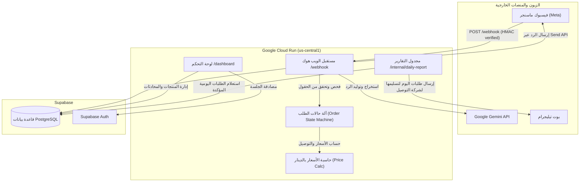

# 🌹 متجر هدايا الحج والعمرة — مساعد مبيعات فيسبوك ماسنجر ولوحة التحكم
### Jordanian Hajj & Umrah Gifts Store — Facebook Messenger AI Sales Agent & RTL Dashboard

نظام متكامل لأتمتة مبيعات متجر بضائع وهدايا الحج والعمرة في الأردن عبر Facebook Messenger بالذكاء الاصطناعي (Gemini) وباللهجة الأردنية الطبيعية، مع لوحة تحكم عربية كاملة (RTL) لإدارة المنتجات والمحادثات، وتقرير يومي على تيليجرام بطلبات اليوم لتسليمها لشركة التوصيل.

---

## 📑 المحتويات (Table of Contents)
- [المميزات الرئيسية](#-المميزات-الرئيسية)
- [المخطط المعماري](#-المخطط-المعماري)
- [التقنيات المستخدمة](#-التقنيات-المستخدمة)
- [هيكل المشروع](#-هيكل-المشروع)
- [التشغيل والإعداد المحلي](#-التشغيل-والإعداد-المحلي)
- [قاعدة البيانات والترحيل (Supabase)](#-قاعدة-البيانات-والترحيل-supabase)
- [حساب المدير: البريد وكلمة المرور](#-حساب-المدير-البريد-وكلمة-المرور)
- [ربط فيسبوك ماسنجر (Meta Platform)](#-ربط-فيسبوك-ماسنجر-meta-platform)
- [التقارير اليومية وتيليجرام](#-التقارير-اليومية-وتيليجرام)
- [النشر على Google Cloud Run](#-النشر-على-google-cloud-run)
- [الفحوصات والاختبارات (Automated Tests)](#-الفحوصات-والاختبارات)

---

## ✨ المميزات الرئيسية

1. **محادثة طبيعية باللهجة الأردنية:**
   - يفهم العبارات والمصطلحات الأردنية ("يا هلا"، "بدي سجادة صلاة"، "كم واصل لإربد"، "اعتمد الطلب").
   - اقتراح ذكي للمنتجات من الكتالوج الفعلي فقط مع منع تام لاختلاق منتجات غير متوفرة أو تعديل الأسعار.
   - يتعرف على المنتج من صورة يبعثها الزبون، بمقارنتها بصور وأسماء منتجات الكتالوج.
   - تنبيه فوري على تيليجرام لما يكون الزبون معصّب أو زعلان، مع رابط صندوق رسائل الصفحة.
2. **جمع الطلبات المرن (Step-by-Step أو All-at-Once):**
   - يدعم إرسال الزبون لكل التفاصيل دفعة واحدة (الاسم، الهاتف، المحافظة، العنوان) ويقفز مباشرة إلى ملخص التأكيد.
   - يدعم جمع البيانات خطوة بخطوة في حال أرسلها الزبون مجزأة.
3. **حساب مالي دقيق بالدينار الأردني (JOD):**
   - العمليات الحسابية تتم برمجياً عبر بايثون حصراً (وليس عبر الذكاء الاصطناعي) بدقة 3 خانات عشرية (فلس).
   - رسوم توصيل ثابتة لكل المحافظات الـ 12 (رسوم شركة التوصيل) تُحدد من صفحة الإعدادات.
4. **تطبيع والتحقق من أرقام الهواتف الأردنية:**
   - تحويل الأرقام المكتوبة بالأرقام الهندية (٠-٩) وصيغ الدولي (+962, 00962) إلى الصيغة القياسية (07XXXXXXXX لزين، أورنج، أمنية).
5. **لوحة تحكم عربية بالكامل (Bootstrap 5 RTL):**
   - واجهة مريحة لصاحب المتجر بدون الحاجة لكتابة كود.
   - إدارة المنتجات (بدون كميات مخزون)، ومحاكي لتجربة البوت (مع إرفاق صور).
6. **تقرير يومي عبر تيليجرام لتسليم الطلبات لشركة التوصيل (الساعة 10:00 مساءً):**
   - تقرير منسق يوضح الطلبات المؤكدة اليومية، تفاصيل المستلم وعنوانه، والمبلغ المطلوب تحصيله كاش (دفع عند الاستلام).
7. **حماية مجانية Supabase من الإيقاف التلقائي:**
   - فحص دوري يومي عبر `/health` و `/internal/daily-report` يمنع دخول قاعدة البيانات في وضع السكون (Auto-pause).

---

## 🏛️ المخطط المعماري



---

## 🛠️ التقنيات المستخدمة

- **لغة البرمجة:** Python 3.11+
- **إطار العمل الخلفي:** FastAPI
- **قاعدة البيانات والمصادقة:** Supabase (PostgreSQL + Supabase Auth)
- **محرك الذكاء الاصطناعي:** Google Gemini 2.5 Flash (`google-genai` SDK)
- **واجهة لوحة التحكم:** HTML5 + Jinja2 + Bootstrap 5 RTL + CSS3 Custom Theme
- **منصة المراسلة:** Meta Messenger Graph API v21.0
- **التقارير اليومية:** Telegram Bot API
- **بيئة النشر السحابي:** Google Cloud Run (Region: `us-central1` Free Tier)
- **الجدولة السحابية:** Google Cloud Scheduler

---

## 📁 هيكل المشروع

```
Messenger_Agent/
├── app/
│   ├── ai/                    # تكامل مزود الذكاء الاصطناعي (Gemini) وبناء التوجيهات
│   ├── dashboard/             # مسارات ولوحة تحكم المتجر (Auth, Products, Conversations, ...)
│   ├── db/                    # عميل Supabase ومستودعات البيانات (Repositories)
│   ├── messenger/             # معالج Webhook و Send API وتحقق HMAC والتكرار
│   ├── models/                # نماذج Pydantic v2
│   ├── routes/                # نقاط النهاية الرئيسية (health, webhook, internal)
│   ├── services/              # منطق الأعمال (Order Machine, Price Calc, Normalizer)
│   ├── telegram/              # التقرير اليومي وتنبيهات الزبائن المنزعجين على تيليجرام
│   ├── templates/             # قوالب Jinja2 العربية (RTL)
│   ├── config.py              # إعدادات Pydantic Settings
│   └── main.py                # نقطة تشغيل التطبيق Lifespan
├── deploy/                    # ملفات النشر على Cloud Run و Cloud Scheduler
├── migrations/                # ملفات SQL لإنشاء الجداول والبيانات الأولية
├── scripts/                   # سكريبت البذور ومحاكي المحادثة المحلي
├── static/                    # ملفات CSS و JS الخاصة بلوحة التحكم
└── tests/                     # 39 فحص واختبار مؤتمت بالكامل
```

---

## 🚀 التشغيل والإعداد المحلي

### 1. إنشاء البيئة الافتراضية وتثبيت الاعتماديات:
```bash
python -m venv .venv
# على ويندوز:
.venv\Scripts\activate
# على لينكس/ماك:
source .venv/bin/activate

pip install -r requirements.txt
```

### 2. إعداد ملف المتغيرات `.env`:
انسخ `.env.example` إلى `.env` واملأ بياناتك:
```env
SUPABASE_URL=https://your-project.supabase.co
SUPABASE_ANON_KEY=your-anon-key
SUPABASE_SERVICE_ROLE_KEY=your-service-role-key

GEMINI_API_KEY=your-gemini-api-key
GEMINI_MODEL=gemini-2.5-flash

META_APP_SECRET=your-meta-app-secret
META_PAGE_ACCESS_TOKEN=your-meta-page-access-token
META_VERIFY_TOKEN=your-meta-verify-token

TELEGRAM_BOT_TOKEN=your-telegram-bot-token
TELEGRAM_CHAT_ID=your-telegram-chat-id

INTERNAL_API_TOKEN=your-internal-secure-token
```

### 3. تشغيل السيرفر محلياً:
```bash
uvicorn app.main:app --reload --port 8080
```
- لوحة التحكم: [http://localhost:8080/dashboard](http://localhost:8080/dashboard)
- فحص الصحة: [http://localhost:8080/health](http://localhost:8080/health)

*(في وضع التطوير المحلي يمكنك الدخول بـ `admin@perfumestore.jo` وكلمة المرور `admin123`).*

### 4. تجربة المحادثة مع البوت محلياً (CLI Simulator):
بدون الحاجة لربط فيسبوك بعد، يمكنك تجربة التحدث مع البوت وتجربة تدفق الطلبات:
```bash
python scripts/test_messenger_locally.py
```

---

## 🗄️ قاعدة البيانات والترحيل (Supabase)

تم بناء قاعدة البيانات وفق أفضل الممارسات المعتمدة من Supabase:
- الترحيلات متوفرة في مجلد `migrations/`:
  1. `001_initial_schema.sql`: ينشئ 12 جدولاً بـ UUIDs و RLS وقيود مركبة لعزل المتاجر ومؤشرات جزئية وفهارس للبحث.
  2. `002_seed_data.sql`: يزرع شخصية البوت والأسئلة الشائعة (ومناطق التوصيل القديمة التي يحذفها الترحيل 005).
  3. `003_product_categories.sql`: ينشئ جدول فئات المنتجات (`product_categories`) الذي تديره لوحة التحكم ويتحكم بفلاتر المتجر العام، ويزرع الفئات الافتراضية والفئات المستخدمة حالياً.
  4. `004_product_types.sql`: ينشئ جدول أنواع المنتجات.
  5. `005_drop_delivery_zones.sql`: يحذف مناطق التوصيل لكل محافظة (التوصيل صار برسوم ثابتة من الإعدادات).
- لتطبيقها: انسخ محتوى الملفات بالترتيب والصقها في **Supabase Dashboard → SQL Editor** واضغط Run.

---

## 🔐 حساب المدير: البريد وكلمة المرور

من صفحة **الحساب والأمان** (`/dashboard/account`) يستطيع المدير:
- **تغيير البريد الإلكتروني:** يتطلب كلمة المرور الحالية، ويرسل Supabase رابط تأكيد مجاني إلى البريد الجديد (مثل Gmail). لا يتغير البريد إلا بعد الضغط على الرابط، وهذا يثبت ملكية البريد.
- **تغيير كلمة المرور:** يتطلب كلمة المرور الحالية، ويسجّل الخروج من جميع الأجهزة الأخرى.
- **نسيت كلمة المرور؟** من صفحة الدخول (`/auth/forgot-password`): يُرسل رابط استعادة لمرة واحدة صالح لمدة ساعة إلى البريد.

الحماية: CSRF على كل النماذج، تحديد عدد المحاولات (الدخول، كلمة المرور الحالية، رسائل الاستعادة)، رد موحّد لا يكشف وجود الحساب، إبطال الجلسات بعد تغيير/استعادة كلمة المرور، وعدم تخزين الصفحات في الكاش.

### إعداد Supabase (مرة واحدة)
1. **Authentication → URL Configuration:**
   - **Site URL:** رابط التطبيق (نفس قيمة `APP_BASE_URL`).
   - **Redirect URLs:** أضف `https://YOUR-APP-URL/auth/**` (و `http://localhost:8080/auth/**` للتجربة المحلية).
2. **إرسال الرسائل مجاناً عبر Gmail (Authentication → Emails → SMTP Settings):** خادم Supabase الافتراضي يرسل فقط لأعضاء فريق المشروع وبحد رسالتين تقريباً في الساعة، لذلك فعّل **Custom SMTP** مجاناً بحساب Gmail:
   - فعّل التحقق بخطوتين في حساب Google، ثم أنشئ **App Password** من [myaccount.google.com/apppasswords](https://myaccount.google.com/apppasswords).
   - Host: `smtp.gmail.com` — Port: `587` — Username: بريد Gmail — Password: كلمة مرور التطبيق (16 حرفاً) — Sender email: نفس البريد.
3. **Authentication → Providers → Email:** إذا كان البريد الحالي للمدير غير حقيقي (لا يستقبل رسائل)، أوقف **Secure email change** مؤقتاً، لأنه يطلب تأكيد الرابط من البريد القديم والجديد معاً. أعد تفعيله بعد الانتقال إلى Gmail.

---

## 📱 ربط فيسبوك ماسنجر (Meta Platform)

1. أنشئ تطبيقاً على [developers.facebook.com](https://developers.facebook.com) من نوع **Business**.
2. أضف منتج **Messenger**.
3. في إعدادات Webhooks:
   - **Callback URL:** `https://your-domain.com/webhook`
   - **Verify Token:** القيمة المحددة في `META_VERIFY_TOKEN`.
   - اشترك في الأحداث: `messages`, `messaging_postbacks`, `messaging_handovers`.
4. اربط صفحة الفيسبوك الخاصة بمتجرك واستخرج **Page Access Token**.
5. ملاحظة هامة: يجب تقديم التطبيق لمراجعة **Meta App Review** للحصول على صلاحية `pages_messaging` (Advanced Access) قبل إتاحته لعامة الزبائن.

---

## 🚚 التقارير اليومية وتيليجرام

يتم تجميع كافة الطلبات المؤكدة لليوم الحالي (بتوقيت عمّان Asia/Amman) وإرسالها على تيليجرام، جاهزة لتسليمها لشركة التوصيل.
- يمكن إرسال التقرير فوراً يدوياً من لوحة التحكم: **التقارير → إرسال تقرير اليوم الآن**.
- يتم أتمتته يومياً عبر Cloud Scheduler على الرابط:
  `POST /internal/daily-report` مع هيدر التوثيق `X-Internal-Token`.

---

## ☁️ النشر على Google Cloud Run

```bash
# 1. بناء ونشر الصورة عبر Google Cloud Build
gcloud builds submit --config=deploy/cloudbuild.yaml

# 2. جدولة تقرير تيليجرام اليومي في تمام 10:00 مساءً بتوقيت عمّان
bash deploy/cloud-scheduler.sh
```

---

## 🧪 الفحوصات والاختبارات

تم بناء 39 اختبار فحص مؤتمت تغطي كافة طبقات النظام:
```bash
# تشغيل كامل الفحوصات
pytest tests/ -v
```
- `test_phone_normalizer.py`: فحص تطبيع الأرقام الأردنية والأرقام الهندية والبادئات.
- `test_price_calculator.py`: فحص دقة الأسعار بالفلس (3 خانات) ورفض الكميات السالبة.
- `test_order_state_machine.py`: فحص آلة الحالات، القفز المباشر، التأكيد، والإلغاء.
- `test_product_service.py`: فحص مطابقة أسماء المنتجات العربية وفحص المخزون.
- `test_ai_response_parser.py`: فحص استخراج JSON ومعالجة الحالات الاستثنائية.
- `test_webhook_handler.py`: فحص توثيق توقيع HMAC وعدم تكرار الطلبات (Idempotency).
- `test_report_service.py`: فحص تنسيق تقرير تيليجرام وإرساله.
- `test_dashboard_routes.py`: فحص توجيه تسجيل الدخول وتصفح كافة صفحات اللوحة بنجاح.
